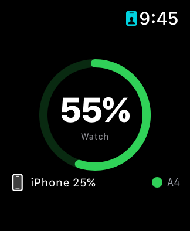
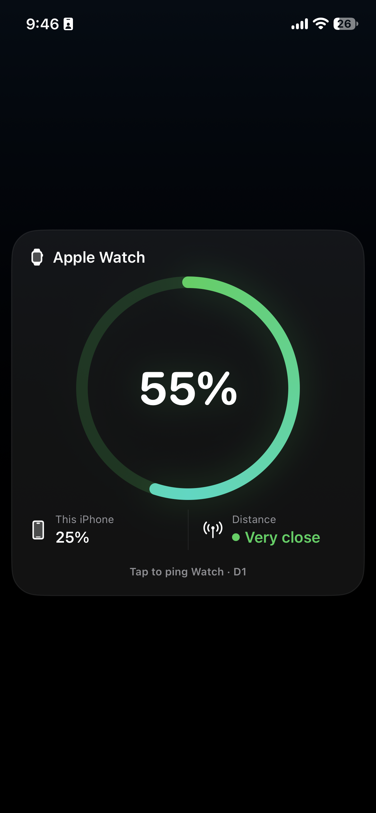

# BatterySync

BatterySync is a local-only iPhone and Apple Watch companion prototype for monitoring battery levels and testing WatchConnectivity.

## Features

- Watch battery percentage displayed on the Watch and iPhone.
- iPhone battery percentage sent to and displayed on the Watch.
- Reachability indicator with a simple colored proximity dot.
- Two-character synchronization token shown on both devices.
- Tapping the Watch token pings the iPhone with repeated sound for approximately five seconds.
- Tapping the iPhone token pings the Watch with repeated haptic notifications for approximately five seconds.
- A Watch battery percentage change triggers one sound on the iPhone.
- Tapping the Watch battery ring requests an immediate local refresh.
- Dark companion-style interfaces on both devices.
- A WidgetKit target is included for Watch/iPhone battery values and the synchronization token.

## Screenshots

### Apple Watch

### iPhone

## Requirements

- Xcode 27.2 or newer.
- iOS and watchOS SDKs installed in Xcode.
- A paired physical iPhone and Apple Watch for WatchConnectivity testing.
- Developer Mode enabled on both devices when installing directly from Xcode.
- The iPhone, Mac, and Watch should be reachable through the same network during wireless development.

## Constraints and limitations

- Watch battery values are supplied by watchOS and may be rounded or cached. The app cannot force a more precise reading than the system exposes.
- A one-second polling timer works while the Watch app is active, but watchOS suspends ordinary apps in the background. Continuous one-second background monitoring is not available to a regular Watch app.
- Background delivery is controlled by watchOS and may be delayed. Extended runtime sessions, background refresh, or a workout session would be needed for longer background execution, each with platform restrictions.
- Exact iPhone-to-Watch distance in meters is not available on the tested Apple Watch SE hardware. The app shows reachability/proximity status instead.
- WatchConnectivity messages require the devices to be paired and reachable. Messages can be delayed when either app is suspended or the devices are out of range.
- The WidgetKit target requires valid Apple Developer signing, an App Group entitlement, and a successfully installed Widget Extension before it appears in the widget gallery.
- This prototype is local-only. It does not use Firebase, a server, or cloud storage.

## Project structure

- `Phone/` — iPhone SwiftUI app and WatchConnectivity receiver.
- `BatterySync Watch Watch App/` — modern watchOS app target and sender.
- `Watch/` — legacy Watch target sources retained for migration compatibility.
- `Widget/` — WidgetKit source and extension Info.plist.
- `BatterySync.xcodeproj/` — Xcode project.
